<p align="center">
  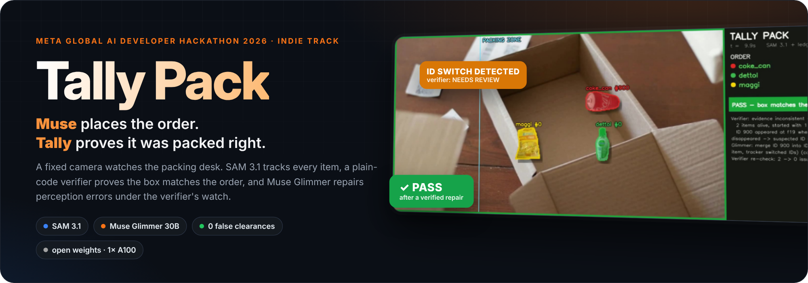
</p>

<p align="center">
  <a href="https://yashwanth-maram.github.io/tally-pack/"></a>
  <a href="docs/tally_pack_demo.mp4"></a>
</p>

<p align="center">
  
  
  
  
  
  
</p>

<p align="center">
  <a href="#-see-it-work"><b>See it work</b></a> ·
  <a href="#-how-it-works"><b>How it works</b></a> ·
  <a href="#-results"><b>Results</b></a> ·
  <a href="#-meta-models-inside"><b>Meta models</b></a> ·
  <a href="#-run-it"><b>Run it</b></a> ·
  <a href="#-engineering-notes"><b>Engineering notes</b></a>
</p>

---

## 🧩 The problem

Meta's **Muse** agent now shops for people. Shopping is its top use case, with average purchases over $200
([Meta Q3 2026](https://s21.q4cdn.com/399680738/files/content_files/META-Q3-2026-Prepared-Remarks.pdf)).
But every box is still **packed by hand**:

<table>
<tr>
<td align="center" width="33%"><h3>2–3 in 100</h3>orders ship with a wrong item<br><sub><a href="https://redstagfulfillment.com/mispick-effects-pcdata-reports-extremely-worrisome-results">industry average</a></sub></td>
<td align="center" width="33%"><h3>$22 each</h3>about $389K per warehouse per year<br><sub><a href="https://www.dcvelocity.com/articles/26321-mispicks-cost-individual-warehouses-389-000-per-year">Intermec study</a></sub></td>
<td align="center" width="33%"><h3>“Muse got it wrong”</h3>the customer blames the agent<br><sub>not the packer</sub></td>
</tr>
</table>

**Tally checks every box at the packing desk before it ships, using only a camera.** It needs no barcodes and no new hardware, and it has no per-call API cost.

---

## 🎬 See it work

<p align="center">
  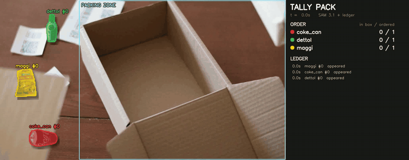
  <br><em><b>Self-repair:</b> the tracker renames the coke (#0 → #900) and the verifier refuses to answer. Muse Glimmer proposes a merge, the verifier re-checks (2 issues → 0), and only then does the box pass.</em>
</p>

<table>
<tr>
<td width="50%" align="center">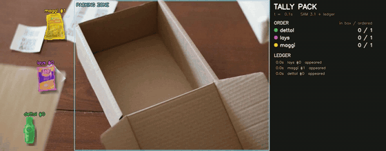<br><b>❌ Missing item, caught</b><br><sub>The Lay's bag never left the table, so the verdict is FAIL with the exact reason.</sub></td>
<td width="50%" align="center">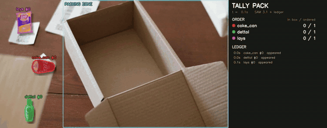<br><b>🙋 Knows when not to answer</b><br><sub>A hand hides the bag and the track jumps. No repair fits, so a human signs off.</sub></td>
</tr>
</table>

> [!TIP]
> **[Open the live demo →](https://yashwanth-maram.github.io/tally-pack/)** Play all 8 cases, or type your own order (“2 maggi and a coke”) and watch the verifier check a packed box in your browser.

---

## 🧠 How it works

<p align="center">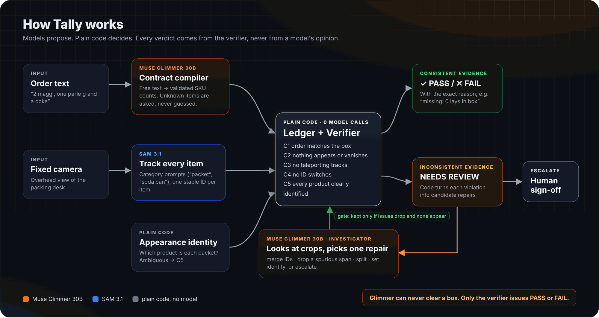</p>

<p align="center">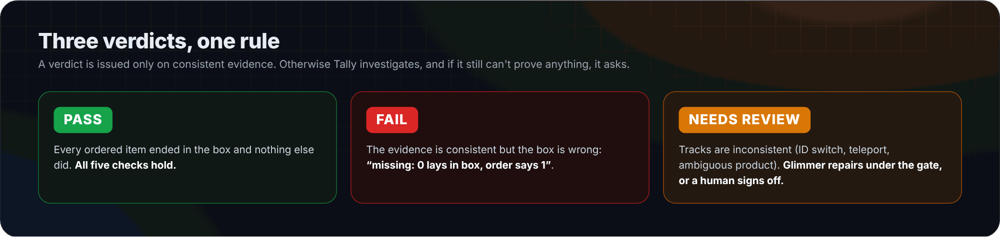</p>

<details>
<summary><b>📋 The five checks and where they live in the code</b></summary>
<br>

| Check | What it proves | Code |
|:--|:--|:--|
| **C1 · order** | Items that ended in the box equal the contract, per product | [`identity.check_order`](tally/identity.py) |
| **C2 · conservation** | No item appears from nowhere or silently disappears | [`ledger.verify`](tally/ledger.py) |
| **C3 · continuity** | No track teleports across the frame | [`ledger.verify`](tally/ledger.py) |
| **C4 · identity** | No ID appears exactly where another just vanished | [`ledger.verify`](tally/ledger.py) |
| **C5 · ambiguity** | Every item's product has a clear appearance match | [`identity.check_order`](tally/identity.py) |

Any of C2–C5 → **NEEDS REVIEW** · only C1 → **FAIL** with the reason · none → **PASS**.
</details>

<details>
<summary><b>🔎 Inside the investigator loop</b></summary>
<br>

1. **Code proposes, not the model.** [`agent.candidates`](tally/agent.py) turns each violation into concrete repairs: C4 → *merge two IDs*; a C3 jump pair → *drop the spurious span*; a single C3 → *split the track*; C5 → *set the product*.
2. **Glimmer looks.** It gets the violations, the recent ledger events and image crops of the items (first, middle and last sighting). It answers in JSON with a candidate number or `"escalate"`, plus a confidence and a one-sentence reason.
3. **The gate decides.** The repair is applied to a copy and the verifier re-runs. The repair is kept **only if integrity issues drop and none appear**. Identity changes also need confidence ≥ 0.8.
4. **It always stops cleanly** in one of three states: `answered`, `awaiting_signoff` or `paused` (at most 4 steps).

```text
Verifier   NEEDS_REVIEW   2 items alive, started with 1 · ID 900 appeared at f19 where ID 0 disappeared
Glimmer    merge ID 900 into ID 0          confidence 0.96 · 11.3 s
           "The can's appearance, orientation and position are consistent across id0 and id900 ..."
Verifier   integrity issues 2 → 0          repair ACCEPTED  →  PASS
```
</details>

---

## 📊 Results

<p align="center">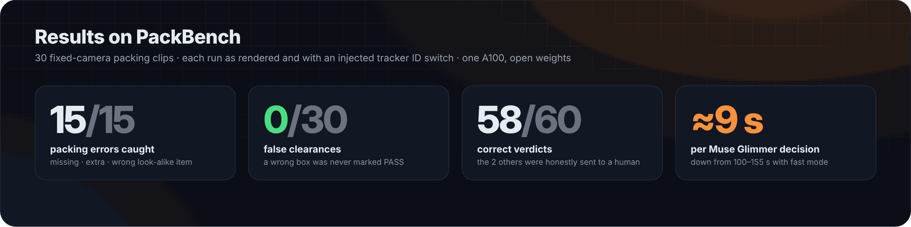</p>

|  | Clean tracks | Injected ID switch |
|:--|:--:|:--:|
| Packing errors caught (missing · extra · wrong item) | **15 / 15** | **15 / 15** |
| **False clearances** (a wrong box marked PASS) | **0 / 15** ✅ | **0 / 15** ✅ |
| Correct verdicts | 29 / 30 | 29 / 30 |
| Sent to a human instead of guessing | 1 | 1 |
| Muse Glimmer calls · average time | 1 · 8.3 s | 31 · 8.8 s |

The two cases that aren't correct are the same clip (`pb_occlusion_4`): SAM's track jumps 620 px under a hand, and Glimmer **escalated instead of guessing**. Raw outputs: [`results/`](results/).

<details>
<summary><b>📉 Ablation: why Tally tracks categories, not brands</b></summary>
<br>

| Variant | Clips | Errors caught | False clearances |
|:--|:--:|:--:|:--:|
| v1: one SAM prompt per brand (“noodle packet”, “biscuit packet”, “chips bag”) | 12 | 4 / 6 | **2 / 6** ❌ |
| v2: SAM tracks the **category** (“packet”), appearance decides the brand, ambiguity → C5 | 30 | 15 / 15 | **0 / 15** ✅ |

SAM 3.1 treats different packet brands as one concept, so brand prompts double-count. Tracking the category and resolving the product from appearance fixed it.
</details>

<details>
<summary><b>⏱️ Speed on one A100</b></summary>
<br>

| Step | Time |
|:--|:--|
| SAM 3.1 tracking | ≈ 12–15 frames/s per prompt |
| Ledger + verifier | milliseconds, zero model calls |
| Muse Glimmer: order → contract | 6.1 s |
| Muse Glimmer: identify a product photo | 2.2 s |
| Muse Glimmer: one investigator decision | ≈ 9 s (was 100–155 s before fast mode) |
| Full 60-case agent evaluation | 297 s |
</details>

> [!NOTE]
> **PackBench is synthetic.** The table, box and hand come from a public Pexels clip, and the products are public Open Food Facts photos cut out with SAM 3.1. The motion is generated, which gives exact ground truth. Real store footage is the next step.

<details>
<summary><b>🖼️ Gallery: the final frame of every showcase case</b></summary>
<br>

<table>
<tr>
<td width="33%"><br><b>✅ Clean box</b></td>
<td width="33%">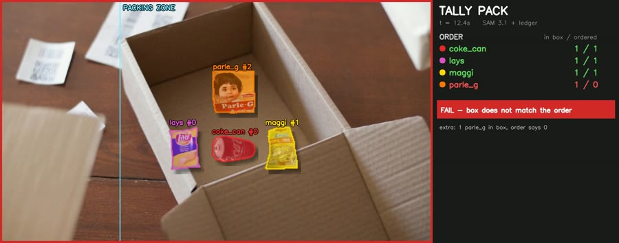<br><b>❌ Extra item</b></td>
<td width="33%">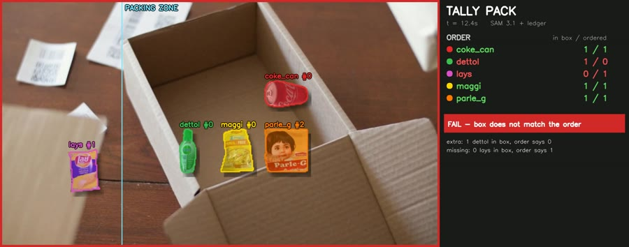<br><b>❌ Look-alike substitute</b></td>
</tr>
<tr>
<td>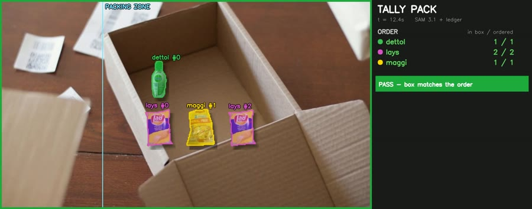<br><b>✅ Twin items under a hand</b></td>
<td>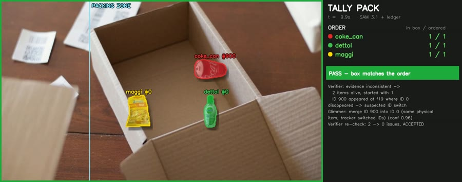<br><b>🛠️ ID switch repaired → PASS</b></td>
<td>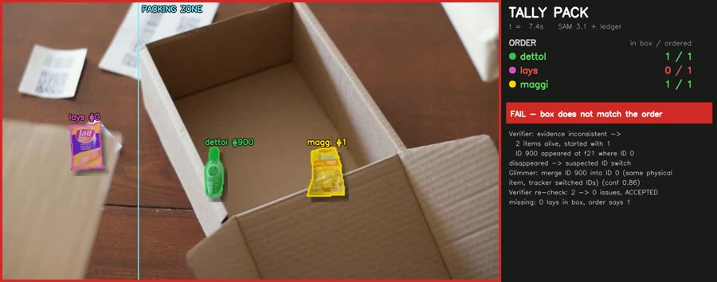<br><b>🛠️ Repaired, still FAIL (really missing)</b></td>
</tr>
</table>
</details>

---

## 🦙 Meta models inside

<table>
<tr>
<td width="50%" valign="top">

### 🔵 SAM 3.1
`facebook/sam3.1` · open weights, run locally

- Text-prompted **video segmentation and tracking** of every item and the box
- Category prompts with one stable ID per item
- Also cuts out the public product photos used to build PackBench

[`perception.py`](tally/perception.py) · [`assets.py`](tally/assets.py)
</td>
<td width="50%" valign="top">

### 🟠 Muse Glimmer 30B
`meta-models/Muse-Glimmer-30B` · Apache-2.0 · 4-bit

- **Contract compiler:** free-text order → validated SKU counts
- **Multimodal investigator:** reads item crops and picks a repair, or escalates
- Fast JSON mode: ≈ 9 s per decision on one A100

[`llm.py`](tally/llm.py) · [`contract.py`](tally/contract.py) · [`agent.py`](tally/agent.py)
</td>
</tr>
</table>

Everything runs on **one A100 with open weights**, with no paid API.

---

## 🚀 Run it

**▶ In the browser.** The [live demo](https://yashwanth-maram.github.io/tally-pack/) needs no install. It plays the real SAM 3.1 + Muse Glimmer outputs, and in *Type an order* it checks a packed box against anything you type. Its verdict logic mirrors [`agent.audit`](tally/agent.py) and was cross-checked against it on every example × clip pair when the page was built.

**💻 The same page locally**
```bash
git clone https://github.com/yashwanth-maram/tally-pack && cd tally-pack/docs
python -m http.server 8000        # open http://localhost:8000
```

<details>
<summary><b>🧪 The full pipeline on a GPU (Colab, one A100)</b></summary>
<br>

```bash
git clone https://github.com/facebookresearch/sam3 /content/sam3        # add to sys.path; do not pip install -e (pins numpy<2)
git clone https://github.com/yashwanth-maram/tally-pack /content/tally-pack
pip install "timm>=1.0.17" ftfy==6.1.1 regex iopath bitsandbytes accelerate gradio
```

```python
import os, sys; sys.path[:0] = ["/content/sam3", "/content/tally-pack"]
from tally import perception as P, contract as C, agent as A, identity as I, llm as LLM

frames_dir = "/content/clip"                       # numbered JPEGs, e.g. P.extract_frames(video, frames_dir)
n = len([f for f in os.listdir(frames_dir) if f.endswith(".jpg")])
tracks = {"n_frames": n, "fps": 10, "size": [960, 540],           # SAM 3.1, one prompt per category
          "prompts": {p: P.track(frames_dir, p) for p in ["cardboard box", "packet", "soda can", "plastic bottle"]}}

contract = C.compile_order("2 maggi, one parle g and a coke")     # Muse Glimmer 30B (4-bit)
cat_skus = {"packet": ["maggi", "parle_g", "lays"], "soda can": ["coke_can"], "plastic bottle": ["dettol"]}
refs = I.reference_descriptors("sprites/", list(C.CATALOG))

report = A.audit(tracks, contract["order"], cat_skus, frames_dir, refs)        # PASS | FAIL | NEEDS_REVIEW
if report["verdict"] == "NEEDS_REVIEW":
    result = A.investigate(tracks, contract["order"], cat_skus, frames_dir, refs, ask=LLM.ask_json)
```

PackBench: [`assets.harvest`](tally/assets.py) → [`packbench.build`](tally/packbench.py) → [`evaluate`](tally/evaluate.py).
Videos, app and site: [`demo.py`](tally/demo.py) · [`ui.py`](tally/ui.py) · [`video.py`](tally/video.py) · [`publish.py`](tally/publish.py).
</details>

---

## 🔧 Engineering notes

<details>
<summary><b>⚡ Muse Glimmer fast mode: 100–155 s → ≈ 9 s per decision</b></summary>
<br>

Glimmer's chat template has a reasoning channel (`to=self`) before the final answer (`to=user`). For short, structured decisions Tally **prefills the final-answer header** `to=user<|message|>`, so the model answers directly in JSON. That is 11–17× faster, with the same PackBench accuracy (58/60, 0 false clearances). See [`llm.chat(fast=True)`](tally/llm.py).
</details>

<details>
<summary><b>🧮 4-bit Glimmer with an exact bf16 vision tower</b></summary>
<br>

bitsandbytes NF4 also quantized the vision tower (skip lists were ignored). The patch embedder then cast pixels to `uint8` and crashed with `LayerNormKernelImpl not implemented for 'Byte'`. [`llm.dequantize_vision`](tally/llm.py) swaps every `Linear4bit` in the vision modules for an exact bf16 `nn.Linear` after loading, so the language model stays 4-bit and fits next to SAM 3.1.
</details>

<details>
<summary><b>🐍 SAM 3.1 on Colab (Python 3.13, numpy 2)</b></summary>
<br>

`pip install -e sam3` pins `numpy<2`, so the repo is added to `sys.path` instead. The predictor is built with `version="sam3.1", use_fa3=False, compile=False`, and `init_state` is patched to drop an unsupported argument ([`perception.py`](tally/perception.py)). Single images are segmented as a 3-frame clip, because one frame returns no masks.
</details>

<details>
<summary><b>🎞️ Demo videos that cannot drift from the evaluation</b></summary>
<br>

[`demo.py`](tally/demo.py) re-runs SAM 3.1 only to recover masks (matched to the cached tracks by IoU) and **replays the saved Glimmer decisions** through the same verifier. All 8 showcase videos reproduce their evaluation verdicts (8/8). The 3-minute video is built entirely from code ([`video.py`](tally/video.py)): cards, clips, captions and a Kokoro-82M voice-over. Nothing was filmed.
</details>

<details>
<summary><b>🗂️ Repository map</b></summary>
<br>

```text
tally/
├── perception.py   SAM 3.1 wrapper: text prompt → per-frame boxes, centroids, IDs
├── ledger.py       zone events + verifier (C2–C4) + verified repair gate
├── identity.py     appearance identity vs catalogue photos (C1, C5)
├── contract.py     order text → validated contract (Muse Glimmer; keyword fallback)
├── llm.py          Muse Glimmer 30B loader (4-bit + bf16 vision), fast JSON mode
├── agent.py        audit → candidate repairs → Glimmer → verifier gate → stop state
├── assets.py       public product photos → SAM 3.1 cut-outs
├── packbench.py    synthetic fixed-camera benchmark with ground truth
├── evaluate.py     scoring, oracle baselines, ID-switch injection
├── demo.py · ui.py         annotated videos + Gradio app
├── video.py · tts.py       the 3-minute submission video, built from code
├── publish.py · site_index.html   README media, results, live demo site
results/            evaluation outputs + benchmark ground truth
docs/               live demo site (GitHub Pages), video, GIFs, art (docs/assets)
```
</details>

---

## ⚠️ Limitations

- Evaluated on a **synthetic** benchmark with a 5-product catalogue and a fixed overhead camera. Real store footage will be messier.
- Product identity uses colour-layout histograms. That is fine for distinct packaging; near-identical variants become C5 and go to a human.
- Fast mode skips Glimmer's reasoning channel. It suits short structured decisions, not open-ended analysis.
- Tally tracks **items, never workers**.

## 📜 Credits & licences

- **Code:** MIT © 2026 Maram Yashwanth ([LICENSE](LICENSE)).
- **Models:** SAM 3.1 and Muse Glimmer 30B by Meta, under their own licences. Narration voice by [Kokoro-82M](https://huggingface.co/hexgrad/Kokoro-82M) (Apache-2.0).
- **Media:** Pexels video by Kampus Production (table, box, hand). Product photos from Open Food Facts / Wikimedia Commons, with per-image licences recorded in `sprites/meta.json` by [`assets.harvest`](tally/assets.py).

<br>
<p align="center">
  <b>Built by Maram Yashwanth</b> · B V Raju Institute of Technology<br>
  <sub>Meta Global AI Developer Hackathon 2026 · Indie track · all code written during the event (<a href="NEW_WORK.md">NEW_WORK.md</a>, commit history)</sub>
</p>
