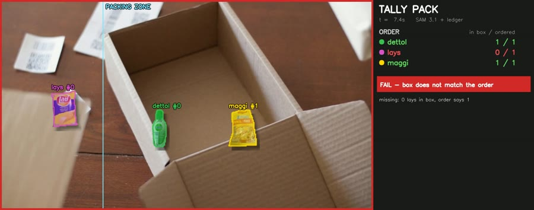
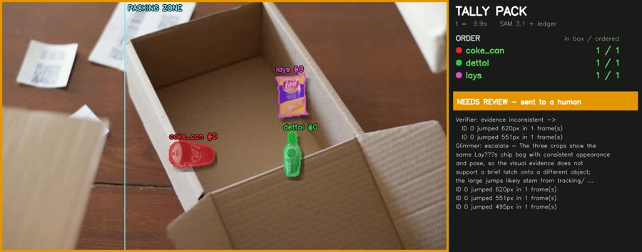
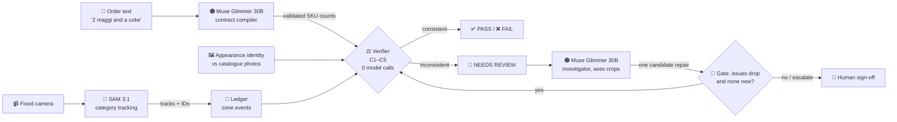

<div align="center">

# 📦 Tally Pack

### Muse places the order. Tally proves it was packed right.

**Camera-verified order packing with Meta's open models.** A fixed camera watches the packing desk,
**SAM 3.1** tracks every item, a deterministic ledger proves the box matches the order, and
**Muse Glimmer 30B** investigates only when the evidence doesn't add up. It never gives a false clearance.

[](https://yashwanth-maram.github.io/tally-pack/)
[](docs/tally_pack_demo.mp4)


-0467DF?logo=meta&logoColor=white)


<sub>A tracker ID switch (coke #0 becomes #900) makes the ledger inconsistent. Muse Glimmer proposes a merge, the verifier re-checks, and only then does the box pass.</sub>

[**Try it live**](https://yashwanth-maram.github.io/tally-pack/) · [**How it works**](#-how-it-works) · [**Results**](#-results) · [**Run it yourself**](#-run-it-yourself) · [**Engineering notes**](#-engineering-notes)

</div>

---

## 🧩 The problem

Meta's Muse agent now shops for people: shopping is its top use case, with average purchases over $200 ([Meta Q3 2026 remarks](https://s21.q4cdn.com/399680738/files/content_files/META-Q3-2026-Prepared-Remarks.pdf)). But the order is still **packed by a person**, and the industry average is a mis-pick on **2–3 of every 100 orders** ([Red Stag](https://redstagfulfillment.com/mispick-effects-pcdata-reports-extremely-worrisome-results)). Each one costs about **$22**, roughly **$389K per warehouse per year** ([DC Velocity, Intermec study](https://www.dcvelocity.com/articles/26321-mispicks-cost-individual-warehouses-389-000-per-year)). The customer doesn't blame the packer. They blame the agent that "bought the wrong thing".

**Tally checks every box at the packing desk, before it ships, using only a camera.** No barcodes, no new hardware, no per-call API cost.

## ✨ What it does

| | |
|---|---|
| 🎯 **Proves the box** | Every item is tracked from the table into the box. The verdict comes from plain-code invariants, not from a model's opinion. |
| 🛠️ **Repairs its own perception** | When SAM 3.1 switches IDs or latches onto the wrong object, Muse Glimmer proposes a fix, and the fix is kept **only if the verifier confirms it**. |
| 🙋 **Knows when not to answer** | If no repair explains the evidence, the box goes to a human with the frames to check. Tally never guesses PASS. |
| 💬 **Takes orders in plain words** | "2 maggi, one parle g and a coke" → Muse Glimmer compiles a validated packing contract in about 6 s. |

<table>
<tr>
<td width="33%"><br><b>❌ Missing item caught</b><br><sub>The Lay's bag never left the table.</sub></td>
<td width="33%"><br><b>❌ Look-alike substitute caught</b><br><sub>Appearance identity against catalogue photos.</sub></td>
<td width="33%"><br><b>❌ Extra item caught</b><br><sub>Something not in the order went into the box.</sub></td>
</tr>
<tr>
<td><br><b>🛠️ ID switch repaired → ✅ PASS</b><br><sub>Muse Glimmer merges the IDs; the verifier accepts.</sub></td>
<td><br><b>✅ Twin items under a hand</b><br><sub>Two identical items cross; counts stay right.</sub></td>
<td><br><b>🙋 Sent to a human</b><br><sub>Glimmer finds no repair that fits, so it escalates.</sub></td>
</tr>
</table>

## 🧠 How it works



**The rule that makes it trustworthy:** a verdict is issued only on consistent evidence. Muse Glimmer can propose, but **only the verifier can issue PASS or FAIL**.

| Check | What it proves | Code |
|---|---|---|
| **C1 order** | Items that ended in the box equal the contract, per SKU | [`identity.check_order`](tally/identity.py) |
| **C2 conservation** | No item appears from nowhere or silently disappears | [`ledger.verify`](tally/ledger.py) |
| **C3 continuity** | No track teleports across the frame | [`ledger.verify`](tally/ledger.py) |
| **C4 identity** | No ID appears exactly where another just vanished (ID switch) | [`ledger.verify`](tally/ledger.py) |
| **C5 ambiguity** | Each item's product identity has a clear winner | [`identity.check_order`](tally/identity.py) |

Any of C2–C5 → **NEEDS REVIEW**. C1 alone → **FAIL** with the exact reason. Nothing → **PASS**.

<details>
<summary><b>🔎 Inside the investigator loop</b> (click to expand)</summary>

1. Deterministic code turns each violation into concrete candidate repairs ([`agent.candidates`](tally/agent.py)):
   C4 → *merge ID b into ID a*; a C3 jump pair → *drop the spurious detections between the jumps*; a single C3 → *split the track*; C5 → *set the identity to SKU x*.
2. Muse Glimmer sees the violations, the recent ledger events and **image crops of the items involved** (first, middle and last sighting), and answers with JSON: a candidate number or `"escalate"`, a confidence and a one-sentence reason.
3. The repair is applied to a copy. The verifier re-runs, and the repair is **accepted only if integrity violations drop and no new ones appear**. Identity choices also need confidence ≥ 0.8.
4. Every run ends in a stop state: `answered`, `awaiting_signoff` or `paused`. Max 4 steps.

Real trace from the hero GIF ([`results/agent_eval_glimmer_fast.json`](results/agent_eval_glimmer_fast.json)):

```text
Verifier:  NEEDS_REVIEW  (2 items alive, started with 1; ID 900 appeared at f19 where ID 0 disappeared)
Glimmer:   merge ID 900 into ID 0  (confidence 0.96, 11.3 s)
           "The can's appearance, orientation and position are consistent across id0 and id900 ..."
Verifier:  integrity issues 2 -> 0  ->  repair ACCEPTED  ->  PASS
```
</details>

## 📊 Results

Measured on **PackBench**: 30 fixed-camera packing clips across 6 scenarios (clean, missing, extra, wrong item, occlusion, twins), with ground truth by construction. Each clip is run twice: as rendered, and with an **injected tracker ID switch**.

| | Clean tracks | Injected ID switch |
|---|:---:|:---:|
| Packing errors caught (missing / extra / wrong) | **15 / 15** | **15 / 15** |
| **False clearances** (a wrong box marked PASS) | **0 / 15** | **0 / 15** |
| Correct verdicts | 29 / 30 | 29 / 30 |
| Sent to a human instead of guessing | 1 | 1 |
| Muse Glimmer calls / avg time per decision | 1 / 8.3 s | 31 / 8.8 s |

Both non-correct cases are the same clip (`pb_occlusion_4`): a hand hides the bag and SAM's track jumps 620 px. Glimmer looked at the crops, found no repair consistent with them, and **escalated instead of guessing**.

<details>
<summary><b>📉 Ablation: why category tracking + appearance identity</b></summary>

| Variant | Clips | Errors caught | False clearances |
|---|:---:|:---:|:---:|
| v1: one SAM prompt per brand ("noodle packet", "biscuit packet", "chips bag") | 12 | 4 / 6 | **2 / 6** ❌ |
| v2: SAM tracks the *category* ("packet"), appearance decides the brand, ambiguity → C5 | 30 | 15 / 15 | **0 / 15** ✅ |

SAM 3.1 treats different packet brands as one concept, so brand-level prompts double-count. Tracking the category and resolving the product from appearance fixed it.
</details>

<details>
<summary><b>⏱️ Speed on one A100</b></summary>

| Step | Time |
|---|---|
| SAM 3.1 tracking | ~12–15 frames/s per prompt (10 fps clips) |
| Ledger + verifier | milliseconds, zero model calls |
| Muse Glimmer: order → contract | 6.1 s |
| Muse Glimmer: identify a product photo | 2.2 s |
| Muse Glimmer: one investigator decision | ≈ 9 s (was 100–155 s before fast mode) |
| Full 60-case agent evaluation | 297 s |
</details>

> [!NOTE]
> **PackBench is synthetic.** The table, box and hand come from a public Pexels clip, and the products are public Open Food Facts photos cut out with SAM 3.1. The motion is generated, which gives exact ground truth. Real dark-store footage is the next step.

## 🚀 Run it yourself

**1. In the browser:** the [live demo](https://yashwanth-maram.github.io/tally-pack/) (GitHub Pages, no install). The showcase videos are real SAM 3.1 + Muse Glimmer outputs, and in the *Type an order* tab the verifier checks a packed box against any order you type. Its verdict logic mirrors [`agent.audit`](tally/agent.py) and was cross-checked against it on every example × clip pair when the page was built.

**2. The same page locally**
```bash
git clone https://github.com/yashwanth-maram/tally-pack && cd tally-pack/docs
python -m http.server 8000   # open http://localhost:8000
```

**3. The full pipeline (Colab, one A100)**
```python
# setup: clone SAM 3.1 (do not pip install -e; it pins numpy<2) and this repo
#   git clone https://github.com/facebookresearch/sam3 /content/sam3
#   git clone https://github.com/yashwanth-maram/tally-pack /content/tally-pack
#   pip install "timm>=1.0.17" ftfy==6.1.1 regex iopath bitsandbytes gradio
import os, sys; sys.path[:0] = ["/content/sam3", "/content/tally-pack"]
from tally import perception as P, contract as C, agent as A, identity as I, llm as LLM

frames_dir = "/content/clip"                                                   # numbered JPEGs, e.g. P.extract_frames(video, frames_dir)
n = len([f for f in os.listdir(frames_dir) if f.endswith(".jpg")])

tracks = {"n_frames": n, "fps": 10, "size": [960, 540],                      # SAM 3.1, one prompt per category
          "prompts": {p: P.track(frames_dir, p) for p in ["cardboard box", "packet", "soda can", "plastic bottle"]}}
contract = C.compile_order("2 maggi, one parle g and a coke")                  # Muse Glimmer 30B (4-bit)
cat_skus = {"packet": ["maggi", "parle_g", "lays"], "soda can": ["coke_can"], "plastic bottle": ["dettol"]}
refs = I.reference_descriptors("sprites/", list(C.CATALOG))
report = A.audit(tracks, contract["order"], cat_skus, frames_dir, refs)       # PASS | FAIL | NEEDS_REVIEW
if report["verdict"] == "NEEDS_REVIEW":
    result = A.investigate(tracks, contract["order"], cat_skus, frames_dir, refs, ask=LLM.ask_json)
```
PackBench is regenerated with [`assets.harvest`](tally/assets.py) and [`packbench.build`](tally/packbench.py), and evaluated with [`evaluate`](tally/evaluate.py). [`demo.py`](tally/demo.py), [`ui.py`](tally/ui.py) and [`video.py`](tally/video.py) produce the videos, the app and the submission video.

## 🔧 Engineering notes

<details>
<summary><b>Muse Glimmer fast mode: 100–155 s → ≈ 9 s per decision</b></summary>

Glimmer's chat template has a reasoning channel (`to=self`) before the final answer (`to=user`). For short, structured decisions we **prefill the final-answer header** `to=user<|message|>` after the generation prompt, so the model answers directly in JSON. That is 11–17× faster, with the same accuracy on PackBench (58/60 correct, 0 false clearances). See [`llm.chat(fast=True)`](tally/llm.py).
</details>

<details>
<summary><b>4-bit Glimmer with an exact bf16 vision tower</b></summary>

bitsandbytes NF4 also quantized the vision tower (skip lists were ignored), and the patch embedder then cast pixels to `uint8`. That raised `LayerNormKernelImpl not implemented for 'Byte'`. [`llm.dequantize_vision`](tally/llm.py) replaces every `Linear4bit` under the vision modules with an exact bf16 `nn.Linear` after loading. The language model stays 4-bit and fits next to SAM 3.1 on one GPU.
</details>

<details>
<summary><b>SAM 3.1 on Colab (Python 3.13, numpy 2)</b></summary>

`pip install -e sam3` pins `numpy<2` and breaks the Colab stack, so the repo is added to `sys.path` instead. The predictor is built with `version="sam3.1", use_fa3=False, compile=False`, and `init_state` is patched to drop an unsupported `offload_state_to_cpu` argument ([`perception.py`](tally/perception.py)). Single images are segmented as a 3-frame clip, because one frame returns no masks ([`assets.segment_image`](tally/assets.py)).
</details>

<details>
<summary><b>Videos that cannot drift from the evaluation</b></summary>

[`demo.py`](tally/demo.py) re-runs SAM 3.1 only to recover masks (matched to cached tracks by IoU) and **replays the saved Glimmer decisions** through the same verifier. All 8 showcase videos reproduce the evaluation verdicts (8/8). The 3-minute video is built entirely from code ([`video.py`](tally/video.py)): cards, clips, burned-in captions and a Kokoro-82M voice-over. Nothing was filmed.
</details>

## 🦙 Meta models used

| Model | Weights | Role in Tally | Code |
|---|---|---|---|
| **SAM 3.1** | `facebook/sam3.1` (open weights, run locally) | Text-prompted video segmentation and tracking of every item and the box; also cuts out the product photos for PackBench | [`perception.py`](tally/perception.py), [`assets.py`](tally/assets.py) |
| **Muse Glimmer 30B** | `meta-models/Muse-Glimmer-30B` (Apache-2.0, 4-bit) | (1) free-text order → validated packing contract; (2) multimodal investigator that picks a repair from item crops, or escalates | [`llm.py`](tally/llm.py), [`contract.py`](tally/contract.py), [`agent.py`](tally/agent.py) |

Everything runs on **one A100** with open weights: no paid API.

## 🗂️ Repository map

```text
tally/
  perception.py  SAM 3.1 wrapper: text prompt -> per-frame boxes, centroids, IDs
  ledger.py      zone events + verifier (C2-C4) + verified repair gate
  identity.py    appearance identity vs catalogue photos (C1, C5)
  contract.py    order text -> validated contract (Muse Glimmer; keyword fallback)
  llm.py         Muse Glimmer 30B loader (4-bit + bf16 vision), fast JSON mode
  agent.py       audit -> candidate repairs -> Glimmer -> verifier gate -> stop state
  assets.py      public product photos -> SAM 3.1 cut-outs
  packbench.py   synthetic fixed-camera benchmark with ground truth
  evaluate.py    scoring, oracle baselines, ID-switch injection
  demo.py ui.py  annotated videos + Gradio app      video.py tts.py  submission video
  publish.py     README media, results, live demo site (docs/index.html)
results/         evaluation outputs and benchmark ground truth
docs/            live demo site (GitHub Pages), demo video, GIFs, stills
```

## ⚠️ Limitations

- Evaluated on a **synthetic** benchmark with a 5-product catalogue and a fixed overhead camera; real store footage will be messier.
- Product identity uses colour-layout histograms, which is enough for distinct packaging but not for near-identical variants (those become C5 → human).
- Fast mode skips Glimmer's reasoning channel. It suits short structured decisions, not open-ended analysis.
- Tally tracks **items, never workers**.

## 📜 Credits & licences

- Code: MIT © 2026 Maram Yashwanth (see [LICENSE](LICENSE)).
- SAM 3.1 and Muse Glimmer by Meta, under their own licences.
- Table, box and hand: Pexels video by Kampus Production (Pexels licence). Product photos: Open Food Facts / Wikimedia Commons; per-image licences are recorded in `sprites/meta.json` when [`assets.harvest`](tally/assets.py) runs.
- Narration voice: [Kokoro-82M](https://huggingface.co/hexgrad/Kokoro-82M) (Apache-2.0).

<div align="center">

**Built by Maram Yashwanth** · B V Raju Institute of Technology · Meta Global AI Developer Hackathon 2026 (Indie track)<br>
All code written during the event; see [NEW_WORK.md](NEW_WORK.md) and the commit history.

</div>
